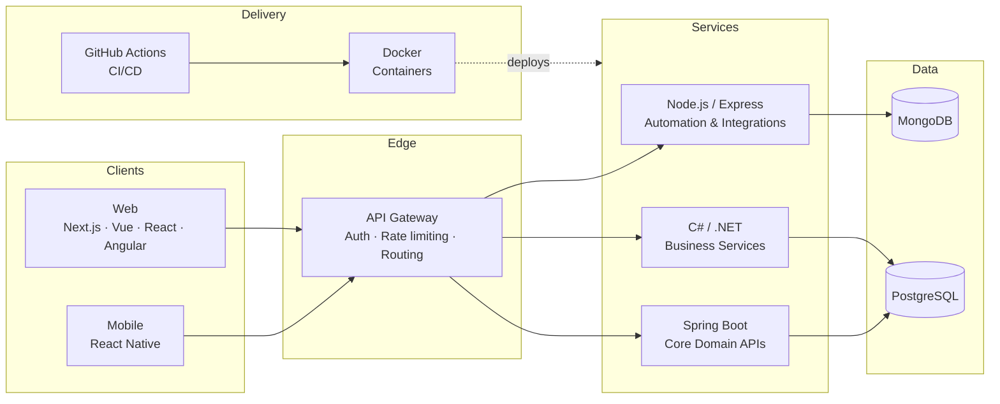
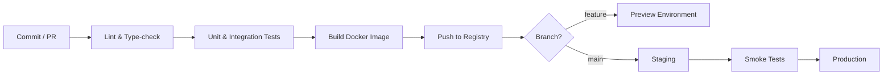

<!-- ═══════════════ HEADER ═══════════════ -->
<div align="center">


<a href="https://github.com/HD-dev">
  
</a>

<br/>

📍 Colombo, Sri Lanka &nbsp;|&nbsp; 💼 3+ Years Experience &nbsp;|&nbsp; 🟢 Open to Remote · On-site · Contract · Full-time

<br/>

[](https://github.com/HD-dev)
[](https://github.com/HD-dev?tab=followers)
[](https://github.com/HD-dev?tab=stars)

</div>

---

## 👋 About Me

I build production-grade **web and mobile applications** and automation workflows that cut manual effort and lift team productivity. I work across **Next.js / Vue / React Native** on the front, **Node.js, C# / .NET and Java Spring Boot** on the back, and I design the systems around them: service boundaries, APIs, data models, and CI/CD.

```ts
const hiruna = {
  role:        ["Full-Stack Developer", "Automation Specialist", "System Architect"],
  location:    "Colombo, Sri Lanka 🇱🇰",
  experience:  "3+ years",
  recognition: "Best Employee 2025 @ ProAccount Lanka",
  languages:   ["TypeScript", "JavaScript", "C#", "Java"],
  web:         ["Next.js", "React", "Vue", "Angular"],
  mobile:      ["React Native"],
  backend:     ["Node/Express", ".NET", "Spring Boot"],
  strengths:   ["System architecture", "API design", "CI/CD & automation", "Containerization"],
  currentlyLearning: ["PHP", "Distributed systems", "Cloud architecture"],
  openTo:      ["Remote", "On-site", "Contract", "Full-time"],
  philosophy:  "Automate the boring parts. Architect for change.",
};
```

---

## 🛠️ Tech Stack

<div align="center">

| | |
|:---|:---|
| **Languages** |  |
| **Web Frontend** |  |
| **Mobile** |  |
| **Backend** |  |
| **Databases** |  |
| **DevOps** |  |
| **Design & Tools** |  |

</div>

---

## 🏗️ How I Think About Architecture

A reference layout I design around: clean separation between clients, an API layer, independently deployable services, and automated delivery.



<details>
<summary><b>⚙️ Delivery pipeline: from commit to production</b></summary>

<br/>



</details>

<details>
<summary><b>📐 Principles I work by</b></summary>

<br/>

- **Separate concerns:** thin controllers, clear domain layers, replaceable infrastructure
- **Design APIs first:** consistent REST contracts, versioning, and validation at the edge
- **One backend, many clients:** a single API contract serves Next.js, Vue, and React Native alike
- **Automate delivery:** every merge builds, tests, and ships through a pipeline
- **Plan for failure:** observability, retries, and graceful degradation over heroics

</details>

---

## 💼 Experience

### Automation Specialist · ProAccount Lanka (Pvt) Ltd
*2022 – Present · 3+ years*

| Impact | |
|:---|:---|
| 🏆 **Recognition** | Best Employee 2025 for outstanding contributions |
| ⚙️ **Automation** | Designed workflows that reduced manual tasks by **40%+** |
| 🚀 **Full-stack delivery** | Built tools connecting automation backends with responsive frontends |
| 🏗️ **Architecture** | Designed scalable backend services across Node.js, C#/.NET, and Spring Boot |
| 📊 **Productivity** | Custom CI/CD pipelines and automation tooling for the team |

`JavaScript` `TypeScript` `Vue.js` `Next.js` `React Native` `Node.js` `C#` `.NET` `Java` `Spring Boot` `Docker` `GitHub Actions` `MongoDB` `Express.js`

---

## 🚀 Featured Projects

<table>
<tr>
<td width="50%" valign="top">

### 📱 [Easy Invoice.lk](https://github.com/HD-dev/easy-invoice)
Smart invoicing platform for small businesses (web + mobile).

- Invoicing, client management, payment tracking
- Real-time sync between web and mobile
- Responsive UI and secure backend APIs

`Vue.js` `TypeScript` `Node.js` `Express.js` `MongoDB`

[](https://github.com/HD-dev/easy-invoice)

</td>
<td width="50%" valign="top">

### 📝 [Vue Blog Project](https://github.com/HD-dev/vue-blog)
Production-ready blog platform built with Vue 3.

- Auth, comments, categories, and role-based access
- REST API integration and scalable structure
- Typed end to end with TypeScript

`Vue.js` `TypeScript` `Node.js` `Express.js`

[](https://github.com/HD-dev/vue-blog)

</td>
</tr>
</table>

---

## 🎯 Expertise

| Domain | Proficiency | Highlights |
|:---|:---|:---|
| Full-Stack Web Development | `█████████░` 90% | Next.js, Vue, React, Angular · Node.js, Express |
| API Development & Integration | `█████████░` 90% | REST design, Axios, microservice patterns |
| TypeScript & Modern JavaScript | `█████████░` 90% | Type-safe development, ES6+, async/await |
| Automation & CI/CD | `█████████░` 90% | GitHub Actions, Docker, workflow automation |
| Mobile Development | `████████░░` 80% | React Native, shared API contracts with web |
| System Architecture & Design | `████████░░` 80% | Scalable design, microservices, design patterns |
| Backend: C# / .NET | `████████░░` 80% | .NET APIs, enterprise-style backend services |
| Backend: Java / Spring Boot | `████████░░` 80% | Spring Boot, REST services, layered architecture |
| DevOps & Containerization | `████████░░` 80% | Docker, deployment automation |
| Database Design | `████████░░` 80% | MongoDB, PostgreSQL, data modeling |

<details>
<summary><b>🧭 Tech radar</b></summary>

<br/>

| Ring | Technologies |
|:---|:---|
| 🟢 **Core** (daily drivers) | TypeScript · JavaScript · Vue · Next.js · React · Node.js · Express · Docker · GitHub Actions |
| 🔵 **Proficient** | C# / .NET · Java / Spring Boot · React Native · Angular · MongoDB · PostgreSQL |
| 🟡 **Learning** | PHP · Distributed systems · Cloud architecture |
| 🟣 **Exploring** | Microservices at scale · Cloud-native development |

</details>

---

## 🎓 Education

**Software Engineering Degree** · A.T.A.R.I · 2019

---

## 🧭 Now

<table>
<tr>
<td valign="top" width="33%">

**📚 Learning**
- PHP backend development
- Distributed systems
- Cloud architecture

</td>
<td valign="top" width="33%">

**🔨 Building**
- Easy Invoice.lk v2
- Automation workflow optimization tools
- Full-stack SaaS solutions

</td>
<td valign="top" width="33%">

**🔭 Exploring**
- Microservices at scale
- Cloud-native development

</td>
</tr>
</table>

---

## 🤝 Let's Work Together

I'm open to **remote, on-site, contract, and full-time** roles in full-stack development, mobile, backend engineering, automation, and system architecture.

<div align="center">

<a href="#"></a>
<a href="#"></a>
<a href="#"></a>
<a href="https://github.com/HD-dev"></a>

<br/><br/>

<sub>*"Building elegant solutions to complex automation challenges, one commit at a time."*</sub>


</div>
